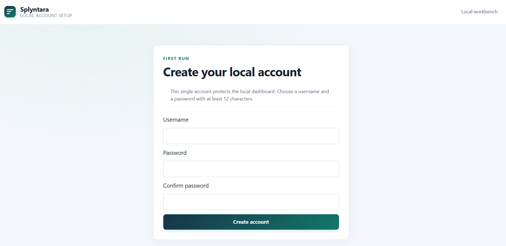
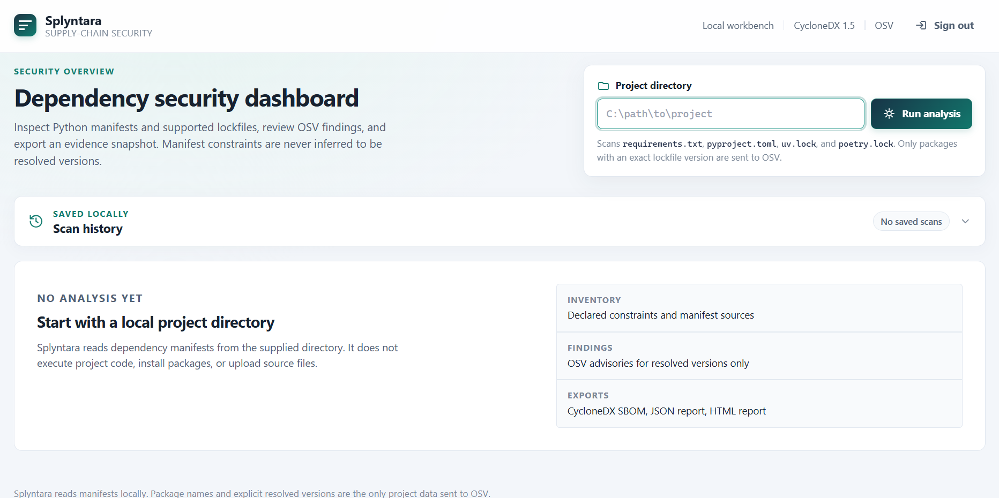
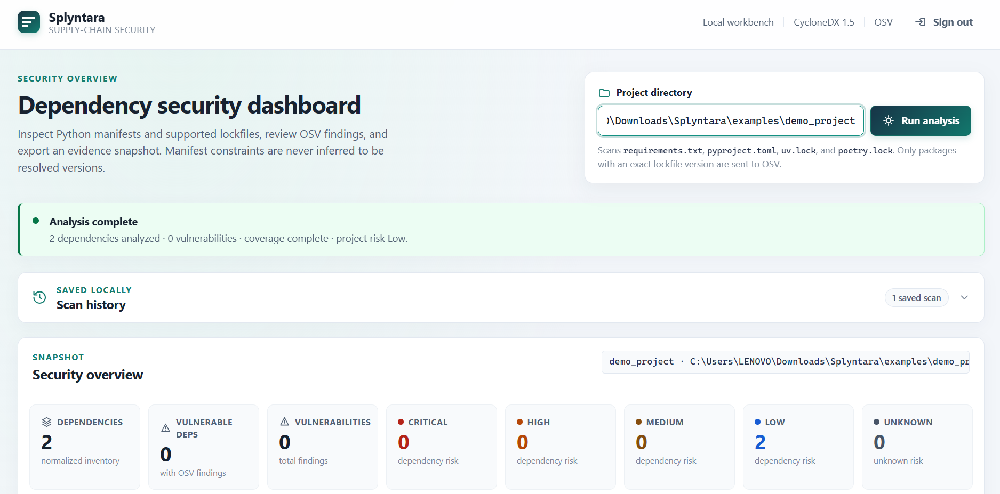
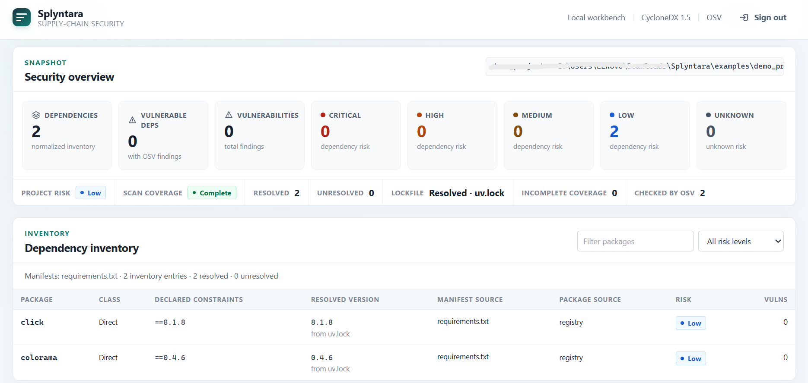
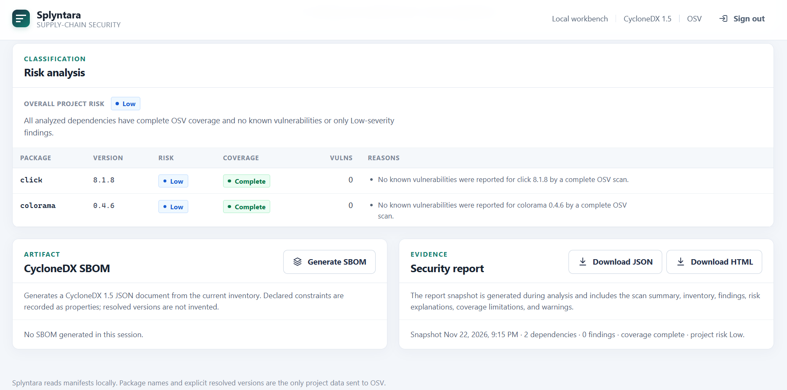
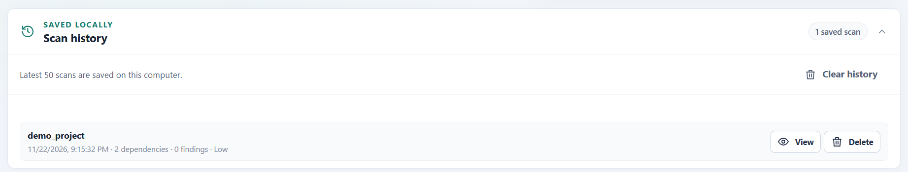
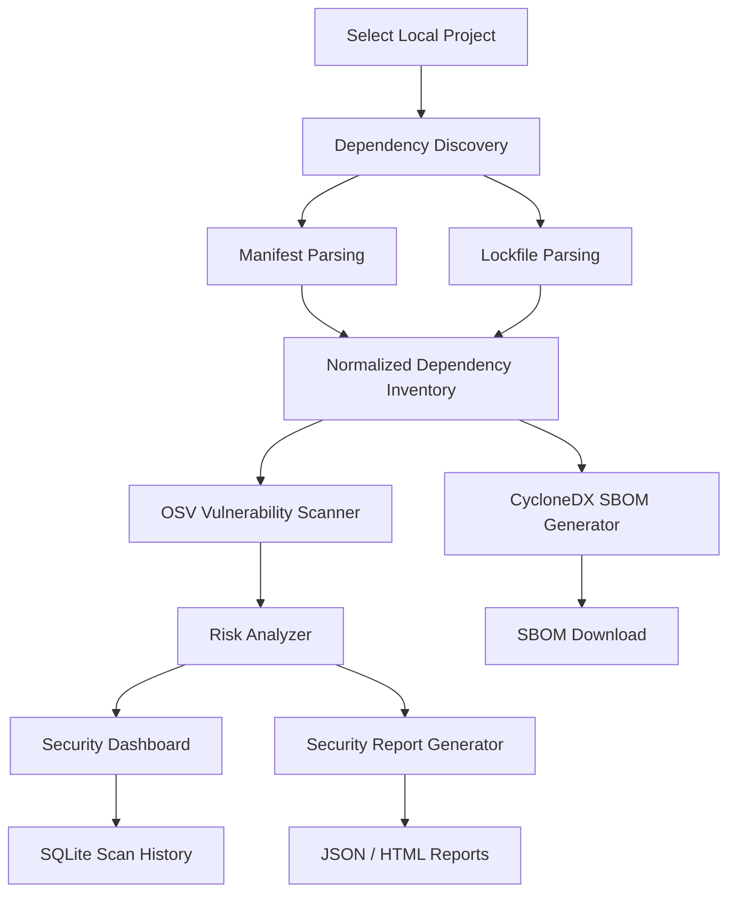

# Splyntara

**A Local Python Software Supply-Chain Security Workbench**

Splyntara is a local software supply-chain security workbench that helps developers inspect Python project dependencies, identify known vulnerabilities, understand dependency risk, and generate Software Bills of Materials (SBOMs).

It discovers dependencies from supported manifests and lockfiles, checks resolved package versions against the [OSV vulnerability database](https://osv.dev/), classifies dependency and project risk, and generates CycloneDX SBOMs and security reports.

Splyntara runs locally, does not install or execute code from analyzed projects, and keeps scan data in a local SQLite database.

---

## Key Features

- **Dependency Discovery:** Discover Python dependencies from `requirements.txt` and `pyproject.toml`.
- **Lockfile Support:** Parse `uv.lock` and `poetry.lock` to obtain resolved package versions and dependency relationships.
- **Normalized Inventory:** Track direct and transitive dependencies, declarations, optional groups, duplicates, conflicts, and package metadata.
- **Vulnerability Scanning:** Query OSV for known vulnerabilities affecting packages with valid resolved versions.
- **Risk Analysis:** Classify dependencies and overall project risk as Critical, High, Medium, Low, or Unknown.
- **CycloneDX SBOM:** Generate CycloneDX 1.5 JSON Software Bills of Materials.
- **Security Dashboard:** Review dependency inventory, vulnerability findings, risk classifications, and scan coverage.
- **Security Reports:** Export standalone JSON and HTML security reports.
- **Scan History:** Save, reopen, and delete previous analyses through the local dashboard.
- **Local Authentication:** Protect the dashboard and API with a password-protected local account.
- **Security Hardening:** Apply request-size limits, filesystem safeguards, CSRF protection, secure session settings, and safe download headers.

---

## Screenshots

### 1. Account Setup
Initial local account creation and setup.



### 2. Dashboard Overview
Main dashboard displaying the project analysis summary.



### 3. Dependency Security Dashboard
Dependency security status and vulnerability overview.



### 4. Security Overview & Dependency Inventory
Security findings alongside the discovered dependency inventory.



### 5. Risk Analysis & Artifact
Project risk assessment, coverage explanations, and export controls.



### 6. Scan History
Previously saved project analysis snapshots.



---

## Architecture

Splyntara uses a modular Flask architecture. Each major stage of the dependency-security workflow is separated into dedicated services.



### Analysis Workflow

1. The user selects a local Python project directory.
2. Splyntara discovers supported dependency manifests and lockfiles.
3. Manifest declarations and lockfile records are parsed and normalized.
4. Resolved package versions are obtained from supported lockfiles when available.
5. Eligible dependencies are submitted to OSV for vulnerability information.
6. Vulnerability severity and scan coverage are evaluated.
7. Dependency-level and project-level risk classifications are generated.
8. Results are displayed in the dashboard and can be exported as SBOMs or security reports.
9. Dashboard analyses are saved in local SQLite scan history.

---

## Technology Stack

| Component | Technology |
|---|---|
| Language | Python 3.12 |
| Backend | Flask |
| Database | SQLite |
| Frontend | HTML, CSS, JavaScript |
| Dependency Parsing | `packaging`, TOML parsing |
| Vulnerability Database | OSV |
| SBOM Standard | CycloneDX 1.5 |
| Package Identification | PackageURL (PURL) |
| HTTP Client | Requests |
| Testing | Pytest |

---

## Requirements

- Python 3.12
- pip
- Git
- Network access for live OSV vulnerability lookups

Dependency discovery and SBOM generation work offline. Vulnerability scanning requires network access to OSV.

---

## Installation

Clone the repository:

```bash
git clone https://github.com/karthik-k11/Splyntara.git
cd Splyntara
```

### Windows (PowerShell)

Create and activate a virtual environment:

```powershell
python -m venv .venv
.\.venv\Scripts\Activate.ps1
```

Install runtime dependencies:

```powershell
python -m pip install --upgrade pip
python -m pip install -r requirements.txt
```

### macOS / Linux

```bash
python3.12 -m venv .venv
source .venv/bin/activate

python -m pip install --upgrade pip
python -m pip install -r requirements.txt
```

### Development Dependencies

To install the runtime dependencies and pytest:

```bash
python -m pip install -r requirements-dev.txt
```

No pre-existing SQLite database or `.env` file is required. Splyntara initializes its local database automatically on first startup.

---

## Running Splyntara

From the repository root, run:

### Windows

```powershell
.\.venv\Scripts\python.exe app.py
```

### macOS / Linux

```bash
.venv/bin/python app.py
```

Open the application in your browser:

**http://127.0.0.1:5000/**

On the first visit, create a local username and password. Subsequent visits require authentication.

The application also provides a health endpoint:

```text
http://127.0.0.1:5000/health
```

By default, the Flask server binds to `127.0.0.1:5000` with debug mode disabled.

---

## Using the Dashboard

1. Start the Splyntara application.
2. Create your local account on the first visit or sign in.
3. Enter the absolute path to the Python project you want to analyze.
4. Start the analysis.
5. Review the dependency inventory and vulnerability findings.
6. Examine dependency risk, project risk, and scan coverage.
7. Download the generated SBOM or security report.
8. Reopen previous analyses through the Scan History section.

### Allowed Project Directories

For safety, Splyntara only scans directories under the current user's home
directory by default. To scan projects stored elsewhere, set
`SPLYNTARA_ALLOWED_PROJECT_ROOTS` before starting the application. Separate
multiple roots with the platform path separator (a semicolon on Windows):

```powershell
$env:SPLYNTARA_ALLOWED_PROJECT_ROOTS = "C:\Users\you\Projects;D:\Workspace"
.\.venv\Scripts\python.exe app.py
```

Only add directories you trust and intend Splyntara to inspect. Restart the
application after changing the setting.

---

## Supported Dependency Files

### Dependency Manifests

| Manifest | Supported Information |
|---|---|
| `requirements.txt` | Package names and declared version constraints |
| `pyproject.toml` | PEP 621 dependencies and optional dependencies |
| `pyproject.toml` | Poetry dependencies and dependency groups |

### Lockfiles

| Lockfile | Supported Information |
|---|---|
| `uv.lock` | Resolved versions, package sources, and dependency relationships |
| `poetry.lock` | Resolved versions, package sources, and dependency relationships |

Splyntara parses lockfiles statically as TOML. It does not install packages, execute project code, or contact package indexes to resolve dependencies.

### Dependency Resolution

Manifest declarations and resolved package versions are treated separately.

For example:

```text
requirements.txt

requests==2.31.0
```

Although this declaration contains an exact version pin, it does not establish that the version is actually resolved in the project's environment.

Splyntara therefore relies on supported lockfiles to establish resolved versions for vulnerability scanning and SBOM generation.

When a supported lockfile is available, Splyntara matches manifest declarations to lockfile packages and identifies direct and transitive dependencies where possible.

If both `uv.lock` and `poetry.lock` are present, Splyntara reports the ambiguity and does not arbitrarily select or merge them.

Missing, malformed, empty, unsupported, or unreadable lockfiles do not produce fabricated resolved versions.

---

## Dependency Inventory

Splyntara creates a normalized dependency inventory containing information such as:

- Normalized package names.
- Resolved versions, when available.
- Declared version constraints.
- Direct or transitive dependency classification.
- Manifest source information.
- Optional dependency groups.
- Package source metadata.
- Duplicate and conflicting declarations.
- Dependency relationships from supported lockfiles.
- Resolution and scan status.

Unresolved dependencies remain visible in the inventory rather than being silently excluded.

---

## Vulnerability Scanning

Splyntara uses the [Open Source Vulnerabilities (OSV)](https://osv.dev/) database to identify known vulnerabilities in Python dependencies.

### Scanning Process

1. Dependencies are checked for valid resolved versions.
2. Eligible packages are submitted to the OSV batch query endpoint.
3. Vulnerability references are retrieved.
4. Advisory details are fetched and validated.
5. Results are associated with their corresponding dependencies.
6. Errors and incomplete coverage are reported.

Only packages with explicit, valid resolved versions are submitted to OSV.

The lookup uses package information such as the package name, PyPI ecosystem identifier, and resolved version. Project source files are not uploaded to OSV.

### Coverage and Error Handling

Splyntara reports scanning problems such as:

- Network connection failures.
- Request timeouts.
- Rate limits.
- OSV server errors.
- Invalid API responses.
- Missing or invalid advisory details.
- Partial scan results.

A failed or incomplete scan is not treated as a clean vulnerability result.

Automated tests mock external OSV requests; a live scan requires network connectivity.

---

## Risk Classification

Splyntara classifies dependencies into five risk levels:

| Risk Level | Meaning |
|---|---|
| Critical | A known vulnerability with Critical severity |
| High | A known vulnerability with High severity |
| Medium | A known vulnerability with Medium severity |
| Low | Successfully scanned with no known vulnerabilities |
| Unknown | Resolution, severity, or scan coverage is insufficient |

### Risk Analysis Principles

- The highest known vulnerability severity determines a dependency's vulnerability risk.
- A successfully scanned dependency with no known vulnerabilities is classified as Low.
- A vulnerability without usable severity information remains Unknown.
- Dependencies without resolved versions are classified as Unknown and are not submitted to OSV.
- Partial or unavailable scan coverage is not interpreted as safe.
- Project risk is based on the highest known dependency risk.
- If only Low risk is known while unresolved dependencies or incomplete coverage remain, project risk remains Unknown.

Risk explanations and coverage limitations are included in the analysis results.

---

## CycloneDX SBOM Generation

Splyntara generates Software Bills of Materials using the **CycloneDX 1.5 JSON format**.

Generated SBOMs include:

- Project metadata.
- Splyntara tool metadata.
- Python package components.
- Package URLs (PURLs).
- Exact resolved versions when available.
- Dependency relationships when available.
- Namespaced properties for additional package and declaration metadata.

Manifest constraints are retained as metadata and are not incorrectly represented as resolved component versions.

Generated SBOMs can be downloaded as JSON files.

---

## Security Dashboard

The dashboard provides a consolidated view of the analysis.

It includes:

- Project analysis summary.
- Total dependency count.
- Vulnerable dependency count.
- Severity distribution.
- Project risk classification.
- Dependency inventory.
- Vulnerability findings.
- Dependency-level risk information.
- Lockfile resolution status.
- OSV scan coverage.
- Warnings and errors.
- Search and risk/severity filters.
- Saved scan history.

The dashboard is built using Flask templates, HTML, CSS, and vanilla JavaScript.

---

## Security Reports and Downloads

Splyntara supports two security report formats:

| Format | Description |
|---|---|
| JSON | Structured security analysis data |
| HTML | Standalone, readable security report |

Reports contain:

- Project information.
- Dependency summary.
- Dependency inventory.
- Vulnerability findings.
- Risk classifications.
- Scan coverage.
- Warnings and errors.

Reports are generated from the analysis snapshot. Loading a saved scan does not initiate another OSV request.

Downloads use attachment headers, conservative filenames, and security-related response headers.

---

## Local Authentication and Scan History

Splyntara includes a password-protected local account.

Implemented protections include:

- Werkzeug password hashing.
- Signed login sessions.
- HTTP-only session cookies.
- Secure session cookies.
- SameSite Strict cookie settings.
- Session expiration after 12 hours.
- Login throttling after five failed attempts from the same client address in
  15 minutes.
- CSRF protection for setup, login, and logout forms.
- Authentication protection for dashboard and API routes.

### Scan History

Dashboard analyses are stored in a local SQLite database.

Users can:

- View recent analyses.
- Reopen previously saved results.
- Delete individual scans.
- Clear scan history.

The application retains the latest **50 scans**.

Saved scan information includes project paths, dependency inventories, findings, and report data. Treat the database as sensitive local project information.

The database is stored under the application's `instance/` directory by default.

---

## API Overview

Splyntara exposes local HTTP endpoints for health checks, authentication, dependency discovery, SBOM generation, vulnerability scanning, risk analysis, history, and report generation.

| Method | Endpoint | Purpose |
|---|---|---|
| GET | `/health` | Application health check |
| GET, POST | `/setup` | Create the first local account |
| GET, POST | `/login` | Authenticate a local user |
| POST | `/logout` | End the authenticated session |
| GET | `/` | Render the dashboard |
| GET | `/dashboard` | Dashboard page |
| GET, POST | `/api/dependencies/discover` | Discover and normalize dependencies |
| GET, POST | `/api/sbom/generate` | Generate a CycloneDX SBOM |
| POST | `/api/vulnerabilities/scan` | Scan resolved dependencies through OSV |
| POST | `/api/risks/analyze` | Calculate dependency and project risk |
| POST | `/api/dashboard/analyze` | Execute the combined dashboard analysis |
| GET | `/api/history` | List recent saved scans |
| GET | `/api/history/<id>` | Retrieve a saved scan |
| DELETE | `/api/history/<id>` | Delete one saved scan |
| DELETE | `/api/history` | Delete all saved scans |
| POST | `/api/reports/security` | Generate a JSON or HTML security report |
| GET, POST | `/api/sbom/download` | Download an SBOM |

API routes require an authenticated session.

JSON API requests must contain a JSON object. Request bodies are limited to 1 MiB.

---

## Demo Project

A self-contained example project is included:

```text
examples/
└── demo_project/
    ├── README.md
    ├── requirements.txt
    └── uv.lock
```

The demo contains a simple dependency manifest and can be used to test dependency discovery without requiring an external project.

After starting Splyntara and signing in through the browser, run:

```powershell
$demo = (Resolve-Path .\examples\demo_project).Path

Invoke-RestMethod -Method Post `
  -Uri http://127.0.0.1:5000/api/dependencies/discover `
  -ContentType application/json `
  -Body (@{ project_directory = $demo } | ConvertTo-Json)
```

Generate an SBOM:

```powershell
Invoke-RestMethod -Method Post `
  -Uri http://127.0.0.1:5000/api/sbom/generate `
  -ContentType application/json `
  -Body (@{ project_directory = $demo } | ConvertTo-Json) `
  -OutFile demo-sbom.json
```

The demo pins `click` and `colorama` in `requirements.txt` and resolves their exact versions in `uv.lock`. Analysis can therefore exercise lockfile resolution and OSV scanning with resolved package versions. Live vulnerability results may vary as OSV data changes.

---

## Security and Hardening

Splyntara includes safeguards designed for local project analysis.

- The server binds to `127.0.0.1` by default.
- Debug mode is disabled through the documented startup path.
- Scans are restricted to configured allowed project roots. The default root
  is the current user's home directory; configure
  `SPLYNTARA_ALLOWED_PROJECT_ROOTS` to include additional trusted roots.
- Sign-in is throttled after five failed attempts from one client address
  within 15 minutes.
- Session cookies are marked `Secure`, `HttpOnly`, and `SameSite=Strict`.
- API request bodies are limited to 1 MiB.
- Project manifests and lockfiles are read with file-size limits.
- Manifest and lockfile symlinks must resolve inside the selected project directory.
- Non-regular files are skipped.
- Manifest files larger than 5 MiB are not read.
- Lockfiles larger than 20 MiB are not read.
- API errors avoid exposing internal exception details and operating-system paths.
- Security headers include `X-Content-Type-Options`, `X-Frame-Options`, and `Referrer-Policy`.
- Downloads use safe filenames and `Cache-Control: no-store`.
- OSV advisory responses are validated against the requested vulnerability IDs.

**Important:** Splyntara is designed as a single-user local application, not a shared production service. Do not expose the Flask server directly to a public network.

---

## Running Tests

Install development dependencies:

```powershell
python -m pip install -r requirements-dev.txt
```

Run the complete test suite:

```powershell
.\.venv\Scripts\python.exe -m pytest -q -rs -p no:cacheprovider
```

Run the integration workflow tests:

```powershell
.\.venv\Scripts\python.exe -m pytest -q -rs -p no:cacheprovider tests\test_integration_workflow.py
```

The automated test suite mocks external OSV traffic and does not require live vulnerability database requests.

---

## Project Structure

```text
Splyntara/
│
├── app.py
├── config.py
├── database.py
│
├── services/
│   ├── dependency_discovery.py
│   ├── dependency_parser.py
│   ├── dependency_scanner.py
│   ├── lockfile_parsers.py
│   ├── osv_client.py
│   ├── vulnerability_scanner.py
│   ├── risk_analyzer.py
│   ├── sbom_generator.py
│   ├── security_dashboard.py
│   ├── security_report.py
│   │
│   └── manifest_parsers/
│       ├── common.py
│       ├── requirements.py
│       └── pyproject.py
│
├── templates/
│   ├── dashboard.html
│   └── security_report.html
│
├── static/
│   ├── css/
│   └── js/
│       └── dashboard.js
│
├── tests/
│
├── docs/
│   └── screenshots/
│
├── examples/
│   └── demo_project/
│
├── requirements.txt
├── requirements-dev.txt
├── .gitignore
└── README.md
```

---

## Known Limitations

Splyntara focuses on Python dependency analysis and currently supports a defined set of manifests and lockfiles.

The following limitations are important to understand:

- **Python ecosystem only:** Other package ecosystems and their lockfile formats are not currently supported.
- **Lockfile environment markers:** Platform-specific and extra-specific lockfile markers are preserved but are not evaluated against a selected runtime environment.
- **Manifest-only projects:** Exact manifest pins are not treated as proof of resolved versions. Without a supported lockfile, dependencies may remain Unknown.
- **Multiple lockfiles:** If both supported lockfiles exist, neither is selected automatically.
- **OSV availability:** Vulnerability scanning depends on network access and OSV service availability.
- **Severity information:** Findings without usable severity data remain Unknown.
- **No license compliance analysis:** The application does not currently provide license policy enforcement.
- **No malicious-package detection:** It does not independently detect malicious or suspicious package behavior.
- **No reachability analysis:** It does not determine whether vulnerable code paths are actually used by the application.
- **No EPSS or CVSS v4:** These scoring systems are not currently included.
- **No automatic remediation:** It does not automatically upgrade, patch, or modify project dependencies.
- **No scheduled scans or alerts:** Scans are initiated manually.
- **No long-term trend analytics:** History is limited to the latest 50 saved analyses.
- **No PDF export:** Security reports are available as JSON and HTML.
- **No CLI scanning interface:** The primary user interface is the local web dashboard.
- **No CI/CD integration:** Automated pipeline integration is not currently provided.
- **Single local account:** There are no multi-user roles or team-management features.

---

## Data and Privacy

Splyntara analyzes files from the selected local project directory.

Dependency discovery, lockfile parsing, and SBOM generation are performed locally.

For vulnerability lookups, eligible package identifiers and resolved version information are sent to OSV. Project source files are not uploaded.

Scan history is stored locally in SQLite. Because it contains project paths and dependency information, protect the `instance/` directory and include it in backups if you need to preserve your account and scan history.

Splyntara is an assessment tool. A clean scan does not guarantee that a project is free from vulnerabilities or other security risks.

---

**Splyntara — Understand your dependencies. Identify known vulnerabilities. Make software supply-chain risk visible.**

---